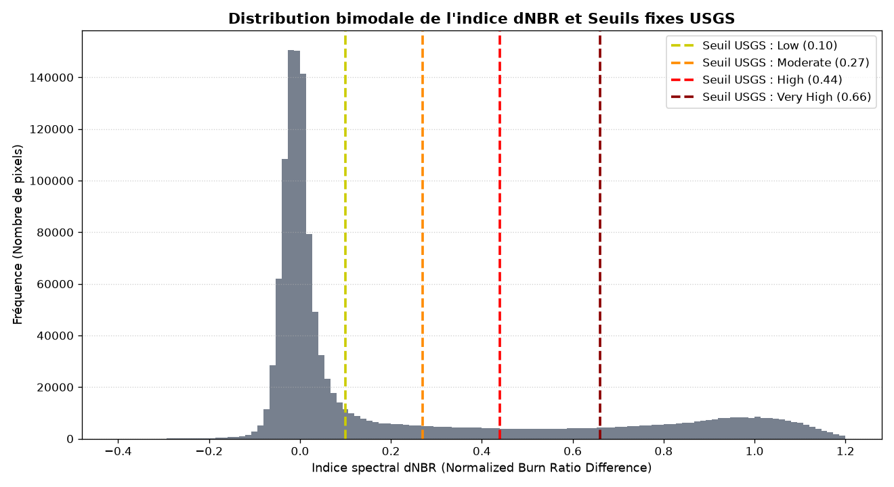
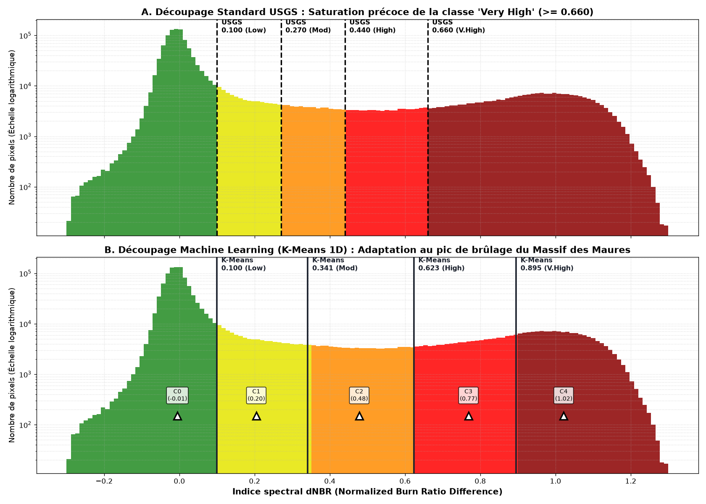
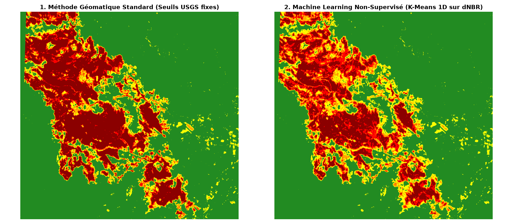
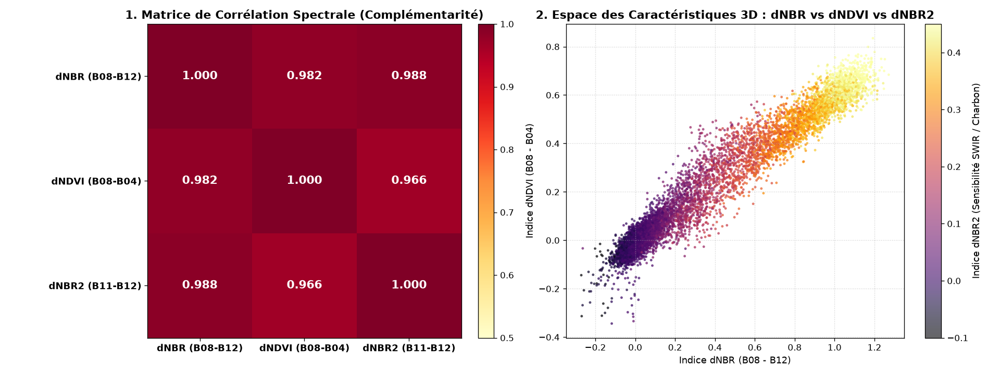
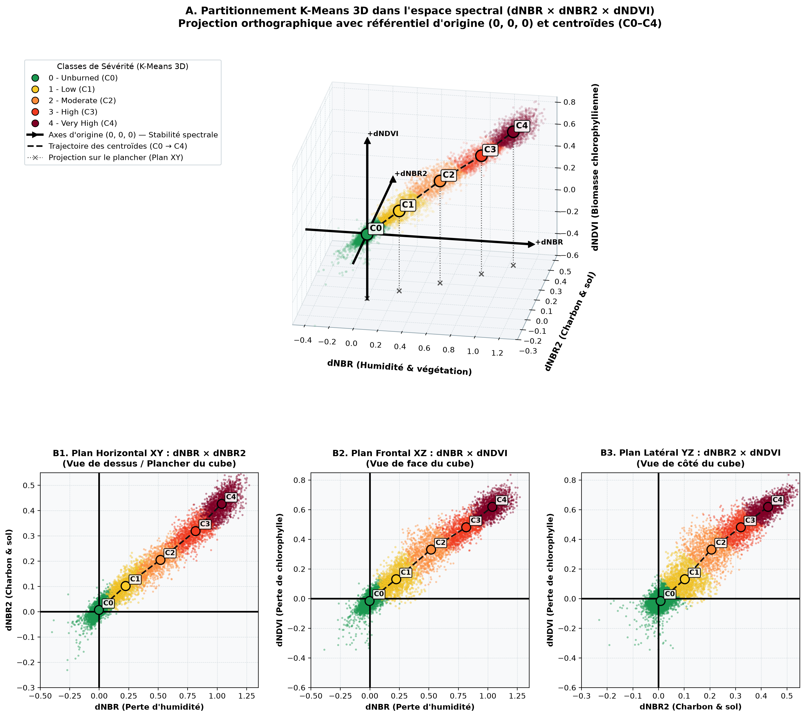
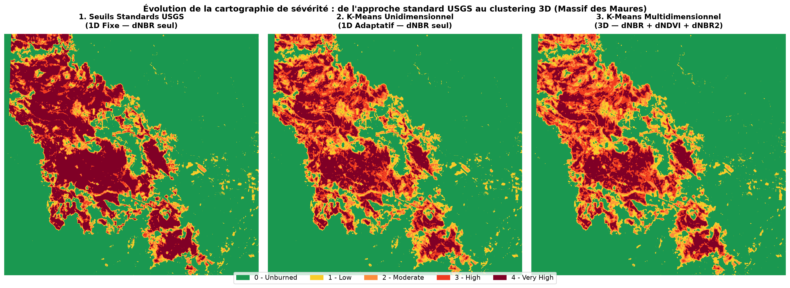

# Cartographie et Analyse de la Sévérité des Incendies par Imagerie Satellitaire Sentinel-2
### *De l'approche géomatique standard (USGS) au Clustering Machine Learning non supervisé (K-Means 1D & 3D)*
**Étude de cas : Incendie du Massif des Maures (Var, France — Août 2021)**


---

## 1. Présentation du Projet

En août 2021, un incendie majeur s'est déclaré dans le **Massif des Maures** (département du Var, France), parcourant plusieurs milliers d'hectares de maquis méditerranéen, de suberaies (forêts de chênes-lièges) et de pinèdes.

Ce dépôt propose une chaîne de traitement complète et reproductible en **Python** permettant de quantifier l'empreinte spatiale et l'intensité des dommages écologiques à partir d'images satellitaires **Copernicus Sentinel-2 L2A** acquises avant (`2021-07-28`) et après (`2021-08-27`) l'événement.

Le projet est structuré selon une **démarche scientifique progressive en trois volets** :
1. **Volet 1 — Approche Géomatique Standard (USGS)** : Calcul des indices spectraux différentiels ($\text{dNBR}$, $\text{dNDVI}$, $\text{dNBR2}$), classification selon la grille internationale de l'USGS, filtrage morphologique du bruit (*sieve*) et vectorisation topologique vers QGIS / WebGIS.
2. **Volet 2 — Approche Machine Learning 1D (*Ceteris Paribus*)** : Confrontation directe entre les seuils fixes de l'USGS et un partitionnement non supervisé **K-Means ($k=5$)** appliqué strictement au même indice unique ($\text{dNBR}$), démontrant l'adaptation mathématique du modèle à la distribution bimodale du maquis méditerranéen.
3. **Volet 3 — Approche Machine Learning Multidimensionnelle (K-Means 3D)** : Exploitation conjointe de l'espace spectral tridimensionnel standardisé ($\text{dNBR} \times \text{dNDVI} \times \text{dNBR2}$) afin de découpler la perte de biomasse chlorophyllienne de la carbonisation minérale du sol.

---

## 2. Architecture du Dépôt

```text
sentinel2-burn-severity-analysis-python/
├── data/                                               # Bandes Sentinel-2 L2A (ignorées par Git)
│   ├── pre_fire/                                       # Acquisition du 2021-07-28 (B04, B08, B11, B12)
│   └── post_fire/                                      # Acquisition du 2021-08-27 (B04, B08, B11, B12)
├── notebooks/                                          # Analyses reproductibles étape par étape
│   ├── burn_severity_analysis.ipynb                    # Volet 1 : Pipeline géomatique USGS & Vectorisation
│   ├── ml_k_means_1D_burn_severity_analysis.ipynb      # Volet 2 : Comparaison USGS vs K-Means 1D (dNBR)
│   └── ml_k_means_3D_burn_severity_analysis.ipynb      # Volet 3 : Clustering K-Means 3D multi-indices
├── outputs/                                            # Cartes, graphiques (.png) et exports SIG (.tif, .geojson)
│   ├── burn_severity.png                               # Carte officielle de sévérité (USGS)
│   ├── eda_dnbr_distribution.png                       # Distribution bimodale du dNBR (Volet 2)
│   ├── histogram_usgs_vs_kmeans1d.png                  # Seuils fixes USGS vs seuils adaptatifs K-Means 1D
│   ├── usgs_vs_kmeans1d.png                            # Comparaison spatiale USGS vs K-Means 1D
│   ├── eda_3d_feature_space.png                        # Corrélation et trajectoire spectrale (Volet 3)
│   ├── comparison_usgs_kmeans1d_kmeans3d.png           # Comparaison spatiale des 3 méthodes
│   └── kmeans_3d_clusters_cube.png                     # Cube 3D orthographique et projections planes 2D
├── src/                                                # Modules Python réutilisables
│   ├── __init__.py
│   ├── indices.py                                      # Calculs matriciels (NBR, dNBR, NDVI, NBR2)
│   └── visualize.py                                    # Fonctions de rendu cartographique
├── requirements.txt                                    # Dépendances Python
└── README.md                                           # Documentation scientifique et technique
```

---

## 3. Données et Fondements Physiques des Indices Spectraux

### Caractéristiques des acquisitions Sentinel-2 L2A
* **Système de coordonnées de référence (CRS)** : `EPSG:32632` (WGS 84 / UTM Zone 32N — projection métrique).
* **Dimensions de la grille raster** : $1185 \times 1127\text{ pixels}$ ($1\,335\,495\text{ pixels}$ au total).
* **Résolution spatiale issue de la transformation affine** : $7,29\text{ m} \times 7,03\text{ m}$, soit **$51,30\text{ m}^2\text{/pixel}$** ($0,00513\text{ ha}$).
* **Superficie totale de la scène étudiée** : **$6\,850,9\text{ ha}$**.

### Formules des indices biophysiques utilisés

| Indice | Formule Spectrale (Sentinel-2) | Signification Biophysique | Plage observée sur le site |
| :--- | :--- | :--- | :---: |
| **NBR** / **dNBR** | $\text{NBR} = \frac{B08 - B12}{B08 + B12}$<br>$\text{dNBR} = \text{NBR}_{\text{pré}} - \text{NBR}_{\text{post}}$ | Contraste entre la réflectance du parenchyme foliaire (NIR, $B08$) et l'absorption hydrique/minérale (SWIR-2, $B12$). Indicateur global de sévérité. | $[-0,800\ ;\ +1,343]$ |
| **NDVI** / **dNDVI** | $\text{NDVI} = \frac{B08 - B04}{B08 + B04}$<br>$\text{dNDVI} = \text{NDVI}_{\text{pré}} - \text{NDVI}_{\text{post}}$ | Mesure directe de l'activité chlorophyllienne (absorption dans le Rouge $B04$). Quantifie la perte de biomasse verte de la canopée. | $[-1,103\ ;\ +0,836]$ |
| **NBR2** / **dNBR2** | $\text{NBR2} = \frac{B11 - B12}{B11 + B12}$<br>$\text{dNBR2} = \text{NBR2}_{\text{pré}} - \text{NBR2}_{\text{post}}$ | Contraste intra-SWIR ($B11$ vs $B12$) particulièrement sensible au dépôt de charbon, aux cendres et à la calcination de la litière au sol. | $[-0,333\ ;\ +0,571]$ |

---

## 4. Volet 1 — Approche Géomatique Standard (USGS)

Notebook associé : [`notebooks/burn_severity_analysis.ipynb`](notebooks/burn_severity_analysis.ipynb)

### Méthodologie SIG
1. **Classification selon la norme USGS** : Application des seuils standards sur la matrice $\text{dNBR}$ ($0,10\ ;\ 0,27\ ;\ 0,44\ ;\ 0,66$).
2. **Post-traitement morphologique (`rasterio.features.sieve`)** : Élimination de l'effet « poivre et sel » en fusionnant les agrégats isolés de moins de $10\text{ pixels}$ ($\approx 513\text{ m}^2$) avec la classe dominante adjacente.
3. **Vectorisation rigoureuse (`GeoPandas` / `Shapely`)** :
   * Extraction des polygones et **calcul des superficies exactes dans le référentiel métrique `EPSG:32632`**.
   * Simplification topologique de Douglas-Peucker (`tolerance = 10.0 m`) en coordonnées métriques.
   * Reprojection finale en `EPSG:4326` (WGS 84) uniquement au moment de l'export `outputs/burn_severity.geojson` pour l'interopérabilité WebGIS.

### Résultats quantitatifs (Volet 1 — USGS Standard)

| Code | Classe de Sévérité | Seuils USGS ($\text{dNBR}$) | Nombre de Pixels | Surface Raster (ha) | Surface Vectorielle (ha) | Part de la Scène (%) |
| :---: | :--- | :---: | :---: | :---: | :---: | :---: |
| **0** | **Unburned** (Non brûlé) | $< 0,10$ | $887\,735$ | $4\,554,0$ | — *(exclu de l'export)* | $66,5\ \%$ |
| **1** | **Low** (Faible) | $[0,10\ ;\ 0,27[$ | $85\,504$ | $438,6$ | $425,1$ | $6,4\ \%$ |
| **2** | **Moderate** (Modérée) | $[0,27\ ;\ 0,44[$ | $56\,021$ | $287,4$ | $281,0$ | $4,2\ \%$ |
| **3** | **High** (Élevée) | $[0,44\ ;\ 0,66[$ | $65\,010$ | $333,5$ | $330,2$ | $4,9\ \%$ |
| **4** | **Very High** (Très élevée) | $\ge 0,66$ | $241\,225$ | $1\,237,5$ | $1\,253,0$ | $18,1\ \%$ |
| **1–4** | **TOTAL BRÛLÉ** | **$\ge 0,10$** | **$447\,760$** | **$2\,297,0\text{ ha}$** | **$2\,289,3\text{ ha}$** | **$33,5\ \%$** |

> *La divergence entre la surface raster brute ($2\,297,0\text{ ha}$) et la couche vectorielle nettoyée ($2\,289,3\text{ ha}$) n'est que de **$7,7\text{ ha}$ ($0,33\ %$)**, validant la conservation topologique du pipeline de généralisation.*


---

## 5. Volet 2 — Approche Machine Learning 1D (*Ceteris Paribus*)

Notebook associé : [`notebooks/ml_k_means_1D_burn_severity_analysis.ipynb`](notebooks/ml_k_means_1D_burn_severity_analysis.ipynb)

### Problématique scientifique : Pourquoi questionner les seuils fixes de l'USGS ?
Les seuils empiriques de l'USGS ont été calibrés sur les forêts tempérées et boréales nord-américaines. Sur le **Massif des Maures**, la combustion rapide du maquis méditerranéen sec génère une distribution statistique **fortement bimodale** avec un second mode culminant autour de $\text{dNBR} \approx 0,90$. Avec le seuil fixe USGS ($\ge 0,66$), plus de la moitié de l'incendie ($1\,237,5\text{ ha}$) se retrouve saturée dans la classe maximale *Very High*.



### Comparaison *Ceteris Paribus* : USGS vs K-Means 1D sur le seul indice $\text{dNBR}$
En appliquant l'algorithme non supervisé `KMeans(n_clusters=5, random_state=42)` uniquement sur le $\text{dNBR}$, les frontières de décision correspondent aux milieux géométriques entre centroïdes triés ($t_i = \frac{C_i + C_{i+1}}{2}$) :

| Transition entre classes | Seuil Fixe USGS ($\text{dNBR}$) | Seuil Adaptatif K-Means 1D ($\text{dNBR}$) | Écart ($\Delta$) | Interprétation Physique |
| :--- | :---: | :---: | :---: | :--- |
| **0 (Unburned) $\rightarrow$ 1 (Low)** | **$0,100$** | **$0,100$** | **$0,000$** | **Convergence absolue** sur la délimitation extérieure du périmètre de feu. |
| **1 (Low) $\rightarrow$ 2 (Moderate)** | $0,270$ | $0,341$ | $+0,071$ | Adaptation à la transition graduelle des lisières. |
| **2 (Moderate) $\rightarrow$ 3 (High)** | $0,440$ | $0,623$ | $+0,183$ | Positionnement au creux inter-modal de la distribution. |
| **3 (High) $\rightarrow$ 4 (Very High)** | $0,660$ | **$0,895$** | **$+0,235$** | **Désaturation du pic de combustion méditerranéen** : seuls les cœurs de feu extrêmes sont classés en niveau 4. |

*Centroïdes 1D appris sur le $\text{dNBR}$ : $C_0 = -0,012\ ;\ C_1 = 0,212\ ;\ C_2 = 0,470\ ;\ C_3 = 0,775\ ;\ C_4 = 1,015$.*





---

## 6. Volet 3 — Approche Machine Learning Multidimensionnelle (K-Means 3D)

Notebook associé : [`notebooks/ml_k_means_3D_burn_severity_analysis.ipynb`](notebooks/ml_k_means_3D_burn_severity_analysis.ipynb)

### Synergie multi-indices et Standardisation (`StandardScaler`)
Un seul indice spectral ne peut pas distinguer parfaitement un assèchement estival de la végétation d'une carbonisation réelle de la litière. Le Volet 3 intègre simultanément les trois dimensions **$(\text{dNBR}, \text{dNDVI}, \text{dNBR2})$**.

Afin d'éviter que le $\text{dNBR}$ (dont l'amplitude est deux fois supérieure à celle du $\text{dNBR2}$) ne domine le calcul de la distance euclidienne tridimensionnelle :
$$d(\mathbf{x}, \mathbf{c}) = \sqrt{(z_{\text{dNBR}} - c_{\text{dNBR}})^2 + (z_{\text{dNDVI}} - c_{\text{dNDVI}})^2 + (z_{\text{dNBR2}} - c_{\text{dNBR2}})^2}$$
chaque indice est préalablement centré-réduit ($z = \frac{x - \mu}{\sigma}$) via `StandardScaler` avant l'entraînement du modèle `KMeans(n_clusters=5, random_state=42)`.



### Coordonnées physiques des 5 centroïdes dans l'espace 3D

| Cluster | Classe de Sévérité | Centroïde $\text{dNBR}$ | Centroïde $\text{dNDVI}$ | Centroïde $\text{dNBR2}$ | Signature biophysique du cluster |
| :---: | :--- | :---: | :---: | :---: | :--- |
| **$C_0$** | **0 - Unburned** | $-0,004$ | $-0,014$ | $+0,007$ | **Origine $(0,0,0)$** : Stabilité spectrale parfaite entre juillet et août. |
| **$C_1$** | **1 - Low** | $+0,224$ | $+0,131$ | $+0,102$ | Stress hydrique périphérique et roussissement partiel du sous-bois. |
| **$C_2$** | **2 - Moderate** | $+0,519$ | $+0,332$ | $+0,206$ | Défoliation marquée de la strate arbustive, altération modérée du sol. |
| **$C_3$** | **3 - High** | $+0,816$ | $+0,481$ | $+0,320$ | Destruction majeure de la canopée et exposition du substrat minéral. |
| **$C_4$** | **4 - Very High** | **$+1,036$** | **$+0,620$** | **$+0,427$** | **Combustion intégrale** : perte totale de chlorophylle et forte couche de cendres/charbon. |

### Visualisation dans l'espace 3D orthographique et projections planes (XY, XZ, YZ)

La figure ci-dessous présente le partitionnement dans le cube spectral 3D (avec le référentiel d'origine $(0,0,0)$ en gras illustrant la stabilité spectrale autour de $C_0$) accompagné des trois projections orthogonales 2D correspondantes :



---

## 7. Synthèse Comparative Globale : USGS vs K-Means 1D vs K-Means 3D

| Code | Classe de Sévérité | 1. USGS Standard (ha) | 2. K-Means 1D [$\text{dNBR}$] (ha) | 3. K-Means 3D [Multi-Indices] (ha) | Part K-Means 3D (%) |
| :---: | :--- | :---: | :---: | :---: | :---: |
| **0** | **Unburned** (Non brûlé) | $4\,554,2$ | $4\,552,2$ | **$4\,589,6$** | $67,0\ \%$ |
| **1** | **Low** (Faible) | $438,6$ | $568,7$ | **$573,9$** | $8,4\ \%$ |
| **2** | **Moderate** (Modérée) | $287,4$ | $433,1$ | **$463,5$** | $6,8\ \%$ |
| **3** | **High** (Élevée) | $333,5$ | $545,4$ | **$576,6$** | $8,4\ \%$ |
| **4** | **Very High** (Très élevée) | $1\,237,5$ | $751,9$ | **$647,6$** | $9,5\ \%$ |
| **1–4** | **TOTAL BRÛLÉ (Classes 1 à 4)** | **$2\,297,0\text{ ha}$** | **$2\,299,1\text{ ha}$** | **$2\,261,6\text{ ha}$** | **$33,1\ \%$** |



### Enseignements clés de la comparaison multi-méthodes
1. **Robustesse du périmètre global de l'incendie** : Les trois méthodes convergent remarquablement sur l'empreinte totale du feu ($\approx 2\,262\text{ à }2\,299\text{ ha}$, soit un tiers de la zone d'étude).
2. **Filtrage des faux positifs par la 3D ($-35,4\text{ ha}$)** : Le passage au K-Means 3D augmente légèrement la classe *Unburned* ($4\,589,6\text{ ha}$ contre $4\,554,2\text{ ha}$). L'ajout conjoint de $\text{dNDVI}$ et $\text{dNBR2}$ permet d'écarter les parcelles agricoles et vignobles périphériques ayant subi un assèchement estival naturel (hausse isolée du $\text{dNBR}$ sans signature de charbon sur le $\text{dNBR2}$).
3. **Hiérarchisation fine au cœur du brasier** : Là où la grille USGS classe massivement $1\,237,5\text{ ha}$ en sévérité maximale (*Very High*), le K-Means 1D ($751,9\text{ ha}$) puis le K-Means 3D ($647,6\text{ ha}$) isolent avec précision les foyers de calcination extrême, permettant aux gestionnaires forestiers (ONF, DFCI) de cibler prioritairement les zones nécessitant une restauration écologique d'urgence.

---

## 8. Installation et Exécution

```bash
# 1. Cloner le dépôt
git clone https://github.com/bronislaw-code/sentinel2-burn-severity-analysis-python.git
cd sentinel2-burn-severity-analysis-python

# 2. Créer et activer l'environnement virtuel Python
python3 -m venv .venv
source .venv/bin/activate

# 3. Installer les dépendances géospatiales et Machine Learning
pip install -r requirements.txt
```

Ouvrir ensuite le dossier dans **VS Code** (en sélectionnant l'interpréteur `.venv/bin/python`) et exécuter successivement les trois notebooks situés dans le répertoire `notebooks/`.