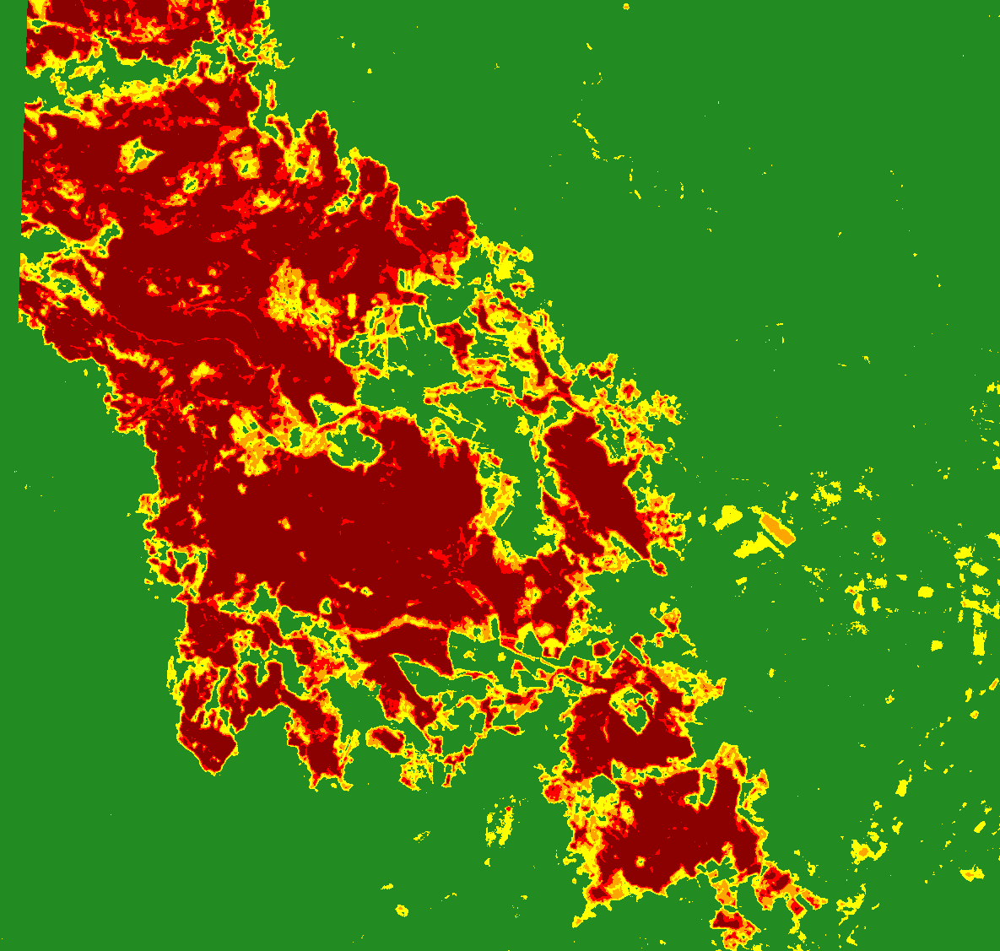

# 🛰️ Sentinel-2 Burn Severity Analysis — Géomatique & Machine Learning

[](https://www.python.org/)
[](https://rasterio.readthedocs.io/)
[](https://geopandas.org/)
[](https://scikit-learn.org/)
[](LICENSE)

Une chaîne de traitement **Spatial Data Science / Code-First** complète en Python pour l'évaluation de la sévérité des feux de forêt via l'imagerie satellitaire **Copernicus Sentinel-2 (L2A)**.  
Étude de cas : **Incendie du Massif des Maures (Var, France) — Août 2021**.

---

## 📌 Architecture du Projet (Deux Approches Complémentaires)

Ce dépôt est structuré en deux volets analytiques situés dans le dossier `notebooks/` :

1. **Volet 1 — Pipeline Géomatique Standard (`notebooks/burn_severity_analysis.ipynb`) :**  
   Calcul matriciel des indices spectraux (**dNBR**, **dNDVI**, **dNBR2**), extraction dynamique de la résolution spatiale via la matrice affine ($51,30\text{ m}^2/\text{px}$), classification selon les **seuils fixes officiels de l'USGS**, filtrage morphologique (`sieve`) et vectorisation topologique (`GeoJSON`).
2. **Volet 2 — Approche Machine Learning Non-Supervisée (`notebooks/ml_k_means_1D_burn_severity_analysis.ipynb`) :**  
   Expérience *Ceteris Paribus* appliquant l'algorithme **K-Means 1D ($k=5$)** strictement sur l'indice **dNBR** afin d'adapter les seuils de sévérité à la réalité écologique du maquis méditerranéen et corriger l'effet de saturation des seuils nord-américains de l'USGS.

---

## 📊 Volet 1 : Résultats Géomatiques Standards (Norme USGS)

### 🗺️ Carte de Sévérité de l'Incendie (Seuils USGS)


### 📈 Bilan des surfaces brûlées (Seuils USGS)

| Code USGS | Classe de Sévérité | Surface Raster (ha) | Surface Vectorielle (ha) | Proportion (%) |
| :---: | :--- | :---: | :---: | :---: |
| **0** | Non brûlé (Unburned) | 4 554,0 ha | - | 66,5 % |
| **1** | Sévérité Faible (Low) | 438,6 ha | 425,1 ha | 6,4 % |
| **2** | Sévérité Modérée (Moderate) | 287,4 ha | 281,0 ha | 4,2 % |
| **3** | Sévérité Haute (High) | 333,5 ha | 330,2 ha | 4,9 % |
| **4** | Sévérité Très Haute (Very High) | 1 237,5 ha | 1 253,0 ha | 18,1 % |
| **-** | **TOTAL BRÛLÉ (Classes 1 à 4)** | **2 297,0 ha** | **2 289,3 ha** | **33,5 %** |

---

## 🤖 Volet 2 : Apport du Machine Learning (K-Means 1D vs Seuils USGS)

Les seuils standards de l'USGS (`0.10`, `0.27`, `0.44`, `0.66`) ont été calibrés pour les hautes forêts résineuses nord-américaines. Dans le **Massif des Maures**, la combustion complète du maquis méditerranéen expose directement la roche et les cendres, générant un pic bimodal de **dNBR** très élevé (entre `0.65` et `1.20`).

### 🔬 Comparaison des seuils de décision (*Ceteris Paribus* sur dNBR)

| Transition entre classes | Seuil Fixe USGS | Seuil Adaptatif K-Means 1D | Interprétation Géomatique & Écologique |
| :--- | :---: | :---: | :--- |
| **0 $\rightarrow$ 1 (Unburned $\rightarrow$ Low)** | **`0.100`** | **`0.100`** | **Convergence parfaite :** Sans connaissance *a priori*, K-Means retrouve la frontière exacte du périmètre brûlé (~2 297 ha). |
| **1 $\rightarrow$ 2 (Low $\rightarrow$ Moderate)** | `0.270` | **`0.341`** | Adaptation à la transition lisière / maquis. |
| **2 $\rightarrow$ 3 (Moderate $\rightarrow$ High)** | `0.440` | **`0.623`** | Décalage vers le second pic bimodal du feu méditerranéen. |
| **3 $\rightarrow$ 4 (High $\rightarrow$ Very High)** | `0.660` | **`0.895`** | **Correction de la saturation :** Isole les véritables épicentres d'extrême calcination ($\ge 0.895$). |

### 📉 Distribution bimodale du dNBR : Découpage USGS vs K-Means 1D


### 🗺️ Comparaison cartographique : Norme USGS vs K-Means 1D


> **Conclusion opérationnelle :** Alors que la norme USGS classe plus de **53 % du sinistre (1 237 ha)** en sévérité maximale (*Very High*), laissant peu de visibilité aux gestionnaires forestiers (ONF / DFCI), la classification **K-Means 1D** segmente finement l'intérieur du brasier et cible avec précision les zones prioritaires de lutte contre l'érosion post-incendie.

---

## 📁 Structure du Dépôt

```text
sentinel2-burn-severity-analysis-python/
├── data/                                            # Bandes Sentinel-2 L2A (ignorées par Git)
├── notebooks/                                       # Notebooks Jupyter d'analyse pas-à-pas
│   ├── burn_severity_analysis.ipynb                 # Volet 1 : Pipeline Géomatique (USGS)
│   └── ml_k_means_1D_burn_severity_analysis.ipynb   # Volet 2 : Machine Learning (K-Means 1D)
├── outputs/                                         # Cartes PNG, Rasters GeoTIFF et GeoJSON
│   ├── burn_severity.png                            # Carte de sévérité USGS (PNG)
│   ├── eda_dnbr_distribution.png                    # Distribution statistique du dNBR
│   ├── histogram_usgs_vs_kmeans1d.png               # Comparaison des seuils sur histogramme log
│   └── usgs_vs_kmeans1d.png                         # Comparaison cartographique USGS vs K-Means
├── src/                                             # Modules Python réutilisables (Principe DRY)
│   ├── indices.py                                   # Calculs matriciels (NBR, dNBR, NDVI, NBR2)
│   └── visualize.py                                 # Palettes et utilitaires graphiques
├── .gitignore                                       # Exclusion des fichiers lourds et de .venv
├── requirements.txt                                 # Dépendances Python
└── README.md                                        # Documentation du projet
